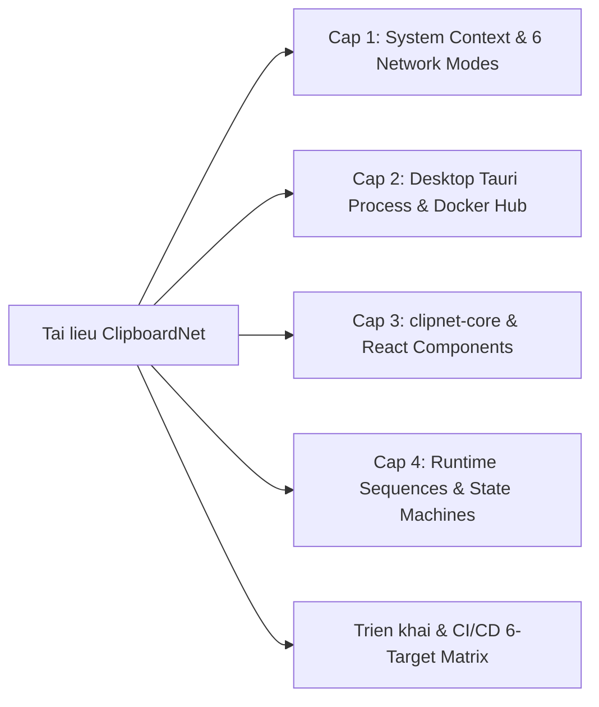

# Tài liệu Kỹ thuật ClipboardNet

Chào mừng đến với trung tâm tài liệu của **ClipboardNet** — ứng dụng đồng bộ clipboard đa nền tảng (**Windows x86_64/ARM64**, **Ubuntu/Debian x86_64/ARM64**, và **macOS Apple Silicon/Intel**) với mã hóa đầu cuối **AES-256-GCM** và **6 phương thức kết nối**.

## Mục lục Tài liệu (`docs/`)

| Tài liệu | Nội dung chính | Đối tượng |
| :--- | :--- | :--- |
| [Kiến trúc Hệ thống Các cấp](architecture.md) | Đồ hình visual C4 (Cấp 1 Context & Topology, Cấp 2 Container & Process, Cấp 3 Component Rust & React, Cấp 4 Sequence & State Machines) | Kiến trúc sư, Contributor |
| [Giao thức, Mã hóa & Bảo mật](protocol-and-security.md) | Đặc tả `WireFrame` & `SyncPayload`, sơ đồ dẫn xuất khóa `HKDF-SHA256`, TLS Cert Pinning, Zero-Knowledge WAN Relay, lọc dữ liệu nhạy cảm | Security Reviewer, Developer |
| [Cài đặt Đa nền tảng & Tự host Hub](deployment.md) | Hướng dẫn cài đặt trên Windows/Ubuntu/macOS, sơ đồ chọn mô hình mạng, triển khai `clipnet-hub` CLI & Docker Compose đa kiến trúc | Người dùng, DevOps / Sysadmin |
| [Pipeline CI/CD & Đóng gói Release](ci-cd-and-release.md) | Đồ hình CI/CD GitHub Actions, ma trận build 6 target + Docker multi-arch, quy trình phát hành `vX.Y.Z` & `SHA256SUMS.txt` | Maintainer, Release Engineer |

## Tổng quan Kiến trúc & Nền tảng Hỗ trợ

| Nền tảng | Kiến trúc | Clipboard Backend | Định dạng Phát hành |
| :--- | :--- | :--- | :--- |
| **Windows 10 / 11** | `x86_64`, `ARM64` | `Win32 Listener` (`clipboard-rs`) | `.msi` (x64), `.exe` NSIS (x64 & ARM64), `clipnet-hub-*.exe` |
| **Ubuntu / Debian** | `x86_64`, `ARM64` | `X11/XWayland (XFixes + INCR)` & `wl-clipboard` fallback | `.deb`, `.AppImage`, `clipnet-hub-linux-*` |
| **macOS 11+** | `Apple Silicon (ARM64)`, `Intel (x86_64)` | `macOS Pasteboard` (`NSPasteboard` via `clipboard-rs`) | `.dmg`, `clipnet-hub-macos-*` |
| **Docker (`clipnet-hub`)** | `linux/amd64`, `linux/arm64` | Headless Axum + Rustls server (non-root `uid 10001`) | `ghcr.io/<owner>/clipnet-hub` |

## Tài liệu Gốc Liên quan

- [README.md](../README.md) — Tổng quan tính năng và hướng dẫn build nhanh
- [CONTRIBUTING.md](../CONTRIBUTING.md) — Yêu cầu môi trường và checklist kiểm thử trước PR
- [SECURITY.md](../SECURITY.md) — Chính sách báo cáo lỗ hổng bảo mật
- [CHANGELOG.md](../CHANGELOG.md) — Lịch sử thay đổi theo chuẩn Keep a Changelog
- [LICENSE](../LICENSE) — Giấy phép mã nguồn mở MIT

