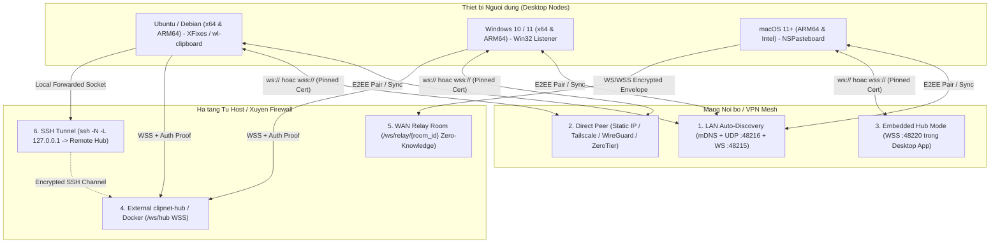
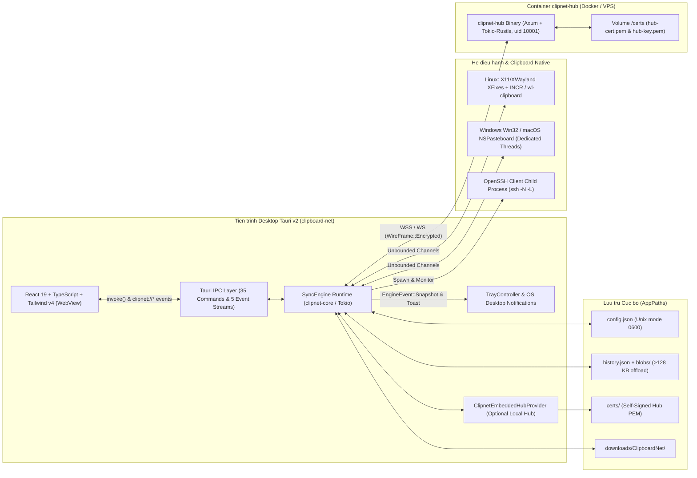
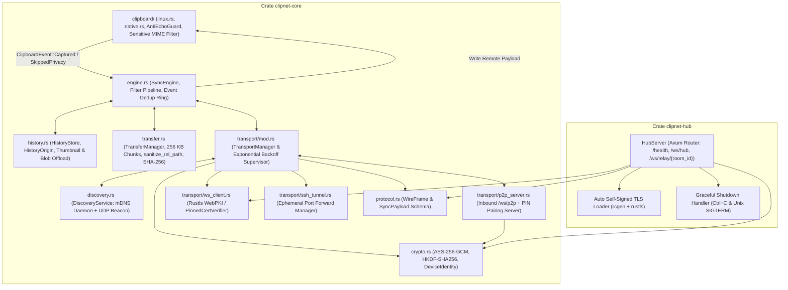
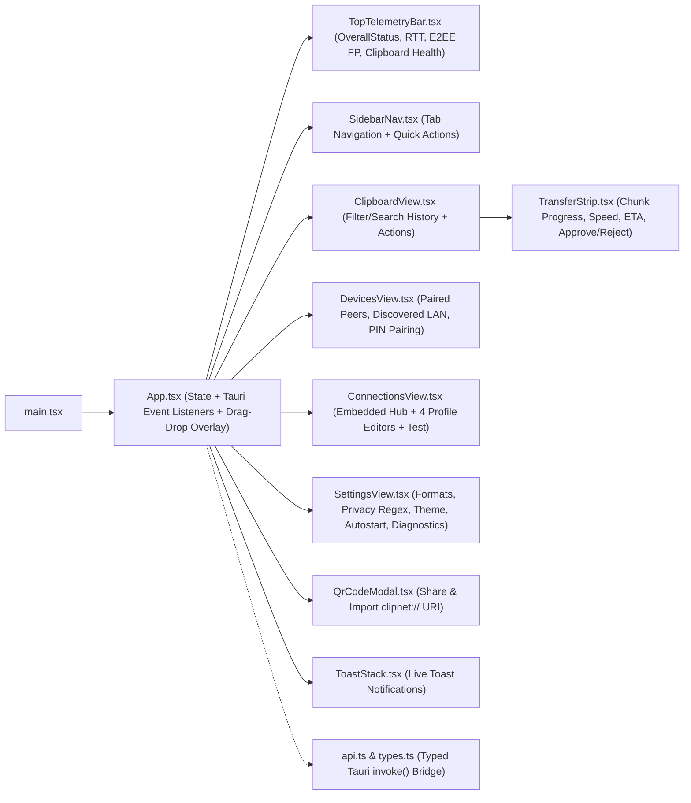
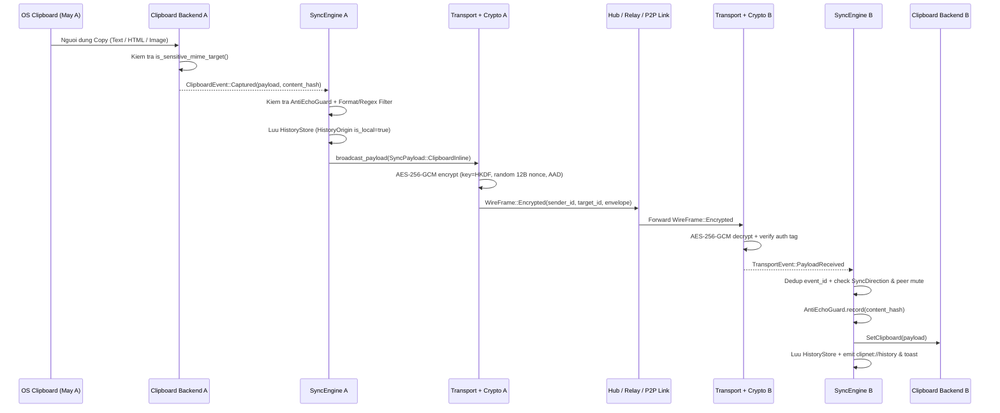
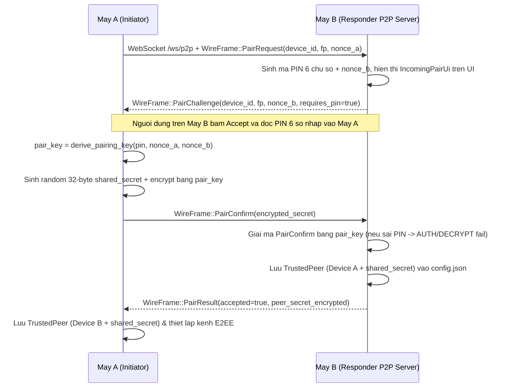
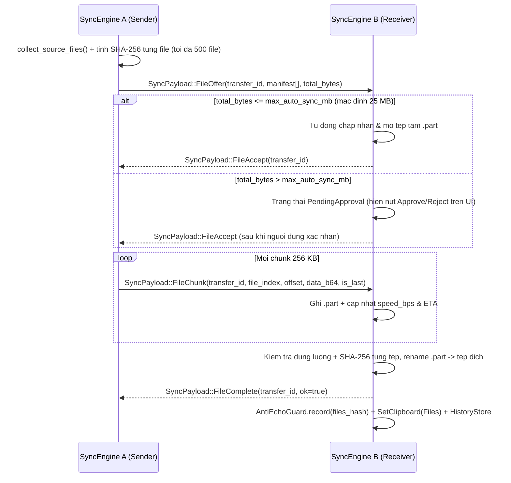
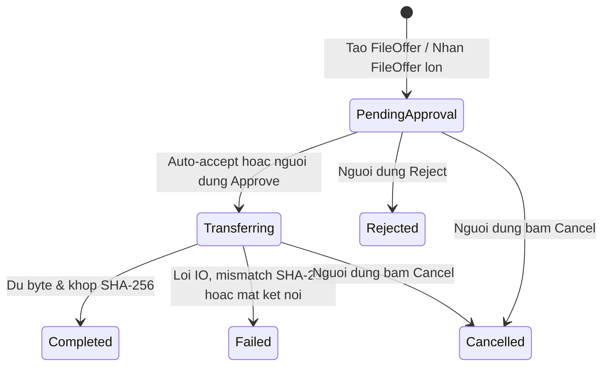

# Kiến trúc Hệ thống Các cấp — ClipboardNet

Tài liệu này mô tả kiến trúc **ClipboardNet** theo mô hình phân cấp **C4 (Context -> Container -> Component -> Runtime Sequence & State)** nhằm giúp kỹ sư và cộng tác viên nắm rõ ranh giới tiến trình, luồng dữ liệu mã hóa và vòng đời đồng bộ đa nền tảng.

---

## Cấp 1 — System Context & 6 Phương thức Kết nối Mạng

Ở mức tổng thể, mỗi thiết bị chạy ứng dụng desktop `ClipboardNet` đóng vai trò một node ngang hàng có danh tính mật mã riêng (`device_id`, `identity_key_hex`, `fingerprint`). Các node có thể đồng bộ trực tiếp hoặc đi qua trung gian tùy bối cảnh mạng:



### Tóm tắt 6 Kênh Giao thông

| # | Chế độ | Cơ chế Khám phá / Định tuyến | Khóa E2EE |
| :---: | :--- | :--- | :--- |
| **1** | **LAN Auto-Discovery** | mDNS `_clipnet._tcp.local.` + UDP broadcast `:48216`, kết nối WS `:48215/ws/p2p` | `shared_secret` riêng từng cặp (tạo khi ghép đôi PIN 6 số) |
| **2** | **Direct Peer** | Kết nối thẳng tới IP/Hostname hoặc VPN mesh (Tailscale, WireGuard, ZeroTier) | `shared_secret` (salt `clipnet-peer-v1`) |
| **3** | **Embedded Hub** | 1 máy desktop bật `HubServer` nội bộ trên `:48220` và tự kết nối qua `127.0.0.1` | `room_secret` của Hub (salt `clipnet-hub-v1`) |
| **4** | **External `clipnet-hub`** | Server Rust độc lập hoặc Docker container chạy trên VPS/NAS | `room_secret` + `auth_proof` SHA-256 |
| **5** | **WAN Relay Room** | Định tuyến theo `room_id = SHA-256("clipnet-room-id-v1:" + room_code)[..16]` | `room_code` (server không giải mã được payload) |
| **6** | **SSH Tunnel** | Tiến trình con `ssh -N -L 127.0.0.1:<port>:<remote>` nối tới Hub nội bộ sau firewall | `room_secret` của Hub đích |

---

## Cấp 2 — Container & Runtime Process Architecture

Sơ đồ cấp 2 thể hiện ranh giới giữa giao diện **WebView (React 19)**, host **Tauri v2**, nhân bất đồng bộ **Tokio (`clipnet-core`)**, các backend clipboard OS, kho lưu trữ cục bộ và tiến trình server **`clipnet-hub`**:



---

## Cấp 3 — Component Architecture

### 3a. Cấu trúc Thành phần bên trong `clipnet-core` & `clipnet-hub`



### 3b. Cấu trúc Thành phần Giao diện Frontend (`src/`)



---

## Cấp 4 — Runtime Sequence & State Machines

### 4a. Chuỗi Đồng bộ Clipboard End-to-End & Chống Vòng lặp (Anti-Echo)



### 4b. Chuỗi Ghép đôi LAN bằng Mã PIN 6 số



### 4c. Chuỗi Truyền File / Thư mục Phân mảnh (256 KB + SHA-256)



### 4d. Máy Trạng thái `OverallStatus` (Tray Badge) & `TransferState`

```mermaid
stateDiagram-v2
    [*] --> Idle
    Idle --> Connected: Co it nhat 1 peer ket noi
    Connected --> Syncing: Dang gui hoac nhan clipboard / file
    Syncing --> Connected: Hoan tat dong bo
    Connected --> Reconnecting: Mat ket noi profile, dang backoff thu lai
    Idle --> Reconnecting: Profile dang bat nhung chua ket noi duoc
    Reconnecting --> Connected: Ket noi thanh cong
    Reconnecting --> Error: Loi cau hinh, sai secret, hoac TLS mismatch
    Connected --> Paused: Nguoi dung chon SyncDirection::Paused
    Idle --> Paused: Nguoi dung chon SyncDirection::Paused
    Paused --> Idle: Resume Sync (0 peers)
    Paused --> Connected: Resume Sync (>= 1 peer)
```



