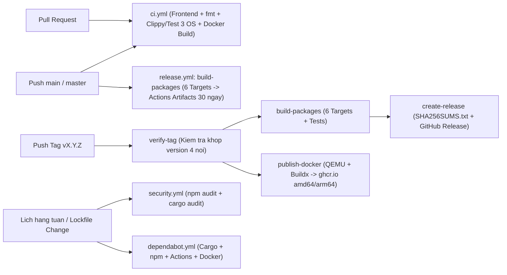

# Pipeline CI/CD & Ma trận Đóng gói Đa nền tảng

Hệ thống CI/CD của **ClipboardNet** chạy trên **GitHub Actions** với nguyên tắc quyền tối thiểu (`permissions: contents: read` ở cấp workflow), cache phụ thuộc Rust/npm/Docker và ma trận biên dịch native cho cả kiến trúc `x86_64` lẫn `ARM64`.

---

## 1. Kiến trúc Tổng thể Pipeline CI/CD



---

## 2. Chi tiết Các Workflow (`.github/workflows/`)

### 2.1 Continuous Integration (`.github/workflows/ci.yml`)
Chạy trên mọi `pull_request`, `push` vào `main`/`master`, và `workflow_dispatch`:
- **`frontend` (`ubuntu-24.04`):** Chạy `npm ci`, `npm run typecheck` (`tsc --noEmit`) và `npm run build` (`tsc && vite build`).
- **`rust-fmt` (`ubuntu-24.04`):** Chạy `cargo fmt --all -- --check`.
- **`rust-check-and-test` (Matrix 3 OS: `ubuntu-24.04`, `windows-latest`, `macos-latest`):**
  - Tạo tệp `dist/index.html` stub để macro `tauri::generate_context!()` biên dịch được mà không cần chạy lại build frontend.
  - Chạy `cargo clippy --workspace --all-targets -- -D warnings` (không chấp nhận bất kỳ cảnh báo nào).
  - Chạy `cargo test --workspace --locked` (11 unit tests trong `clipnet-core` + 3 integration tests TLS Hub / WAN Relay / LAN P2P trong `clipnet-hub`).
- **`docker` (`ubuntu-24.04`):** Kiểm tra build `Dockerfile` (`push: false`, tận dụng `.dockerignore` và GHA build cache).

### 2.2 Multi-Platform Build & Release (`.github/workflows/release.yml`)
Chạy tự động khi **`push` lên `main`/`master`** (xuất GitHub Actions artifacts giữ 30 ngày), khi **`push` tag `v*`** (phát hành GitHub Release + đẩy Docker image lên GHCR), hoặc chạy tay qua **`workflow_dispatch`**:

| Target Name | GitHub Runner | Rust Target Triple | Gói Desktop | Binary Hub | Cờ Môi trường Đặc biệt |
| :--- | :--- | :--- | :--- | :--- | :--- |
| **Windows x86_64** | `windows-latest` | `x86_64-pc-windows-msvc` | `.msi`, `.exe` (NSIS) | `clipnet-hub-windows-x86_64.exe` | — |
| **Windows ARM64** | `windows-11-arm` | `aarch64-pc-windows-msvc` | `.exe` (NSIS) | `clipnet-hub-windows-arm64.exe` | Chỉ bundle NSIS (WiX v3 MSI không hỗ trợ ARM64) |
| **Ubuntu/Debian x86_64** | `ubuntu-24.04` | `x86_64-unknown-linux-gnu` | `.deb`, `.AppImage` | `clipnet-hub-linux-x86_64` | `NO_STRIP=true`, `APPIMAGE_EXTRACT_AND_RUN=1` |
| **Ubuntu/Debian ARM64** | `ubuntu-24.04-arm` | `aarch64-unknown-linux-gnu` | `.deb`, `.AppImage` | `clipnet-hub-linux-arm64` | `NO_STRIP=true`, `APPIMAGE_EXTRACT_AND_RUN=1` |
| **macOS Apple Silicon** | `macos-latest` | `aarch64-apple-darwin` | `.dmg` | `clipnet-hub-macos-arm64` | `CI=true` |
| **macOS Intel** | `macos-latest` | `x86_64-apple-darwin` | `.dmg` | `clipnet-hub-macos-x86_64` | `CI=true` (`run_tests: false`, cross-compile trên runner macOS) |
| **Docker Multi-Arch** | `ubuntu-24.04` + QEMU | `linux/amd64`, `linux/arm64` | — | `ghcr.io/<owner>/clipnet-hub` | Chỉ push khi `refs/tags/v*` |

> **Lưu ý về Runner ARM64 trên GitHub:** `windows-11-arm` và `ubuntu-24.04-arm` miễn phí cho repository **public**; với repository **private**, các job này sử dụng hạn mức phút miễn phí hoặc cấu hình runner tương ứng của gói tài khoản GitHub.

### 2.3 Versioning Tự động theo Commit (`scripts/resolve-build-version.mjs`)
Để mỗi commit mới tạo ra bộ cài **luôn nâng cấp đè được** bản cũ trên hệ điều hành mà không làm bẩn `Cargo.lock` hay các manifest gốc:
- **Build nhánh `main`/`master`, `workflow_dispatch`, hoặc build local (`npm run tauri:build`):**
  - Pipeline (với `fetch-depth: 0` để lấy đủ lịch sử git) và script local tự tính phiên bản theo công thức **`MAJOR.MINOR.<git_commit_count>`** (ví dụ `0.1.6`, `0.1.7`, ...), sau đó truyền vào Tauri qua cờ `--config` tạm thời.
  - **Vì sao dùng số nguyên 3 phần (`0.1.<commit_count>`) thay vì `0.1.0-dev.<commit_count>` hoặc `+sha`?** Windows Installer / WiX (`.msi`) bỏ qua hậu tố pre-release/build metadata trong cơ chế `MajorUpgrade` (gây lỗi *"Another version is already installed"*), còn Debian `dpkg` coi `0.1.0-dev.6 < 0.1.0`. Dạng `MAJOR.MINOR.<commit_count>` tăng đơn điệu và tương thích nâng cấp tại chỗ trên cả **`.deb`**, **`.msi`**, **`.exe` (NSIS)**, **`.AppImage`** và **`.dmg`**.
- **Phát hành chính thức theo Tag (`refs/tags/vX.Y.Z`):**
  - Sử dụng chính xác phiên bản `X.Y.Z` của tag (và kiểm tra khớp với `Cargo.toml`, `package.json`, `src-tauri/tauri.conf.json`).
  - Khi cắt release sau các bản build nhánh, hãy tăng `MINOR` (ví dụ `v0.2.0`) hoặc đặt `PATCH > <commit_count>` hiện tại để tag phát hành chính thức luôn có số phiên bản cao hơn các bản CI build trước đó.

### 2.4 Security & Dependency Hygiene
- **`.github/workflows/security.yml`:** Chạy lúc 03:00 UTC thứ Hai hàng tuần và mỗi khi thay đổi `Cargo.toml`, `Cargo.lock`, `package.json`, hoặc `package-lock.json` để kiểm tra `npm audit --audit-level=high` và `cargo audit`.
- **`.github/dependabot.yml`:** Tạo PR cập nhật hàng tuần cho `cargo`, `npm`, `github-actions` và `docker` (nhóm bản vá minor/patch để giảm nhiễu PR).

---

## 3. Quy trình Phát hành Phiên bản Mới (`vX.Y.Z`)

> **Lưu ý:** Chọn `X.Y.Z` cao hơn mọi build nhánh `MAJOR.MINOR.<commit_count>` trước đó (khuyên dùng tăng `MINOR`, ví dụ từ `0.1.x` lên `0.2.0`, hoặc chọn `PATCH > commit count` hiện tại) để OS installer nâng cấp sạch sẽ.

1. Đồng bộ số phiên bản mới tại **cả 3 tệp**:
   - `Cargo.toml` (`[workspace.package].version`)
   - `package.json` (`"version"`)
   - `src-tauri/tauri.conf.json` (`"version"`)
2. Cập nhật `Cargo.lock` và `package-lock.json` (`cargo check --workspace` và `npm install --package-lock-only`).
3. Di chuyển các mục trong `[Unreleased]` của [CHANGELOG.md](../CHANGELOG.md) sang mục `[X.Y.Z] - YYYY-MM-DD`.
4. Commit, gắn tag và push:
   ```bash
   git add -A
   git commit -m "chore(release): prepare vX.Y.Z"
   git tag -a vX.Y.Z -m "Release vX.Y.Z"
   git push origin main --tags
   ```
5. Job `verify-tag` sẽ đối chiếu tag với cả 3 tệp manifest trước khi build toàn bộ 6 gói cài đặt, tạo `SHA256SUMS.txt` và đăng tải lên GitHub Releases kèm multi-arch image trên `ghcr.io`.

---

## 4. Xử lý Các Lỗi Thường gặp trong CI

- **Ubuntu 24.04 AppImage lỗi `strip` (`.relr.dyn`):** Do `linuxdeploy` dùng `strip` cũ không đọc được ELF `.relr.dyn` trên Ubuntu 24.04 — đã xử lý sẵn bằng `NO_STRIP: "true"` và `APPIMAGE_EXTRACT_AND_RUN: "1"`.
- **macOS `bundle_dmg.sh` bị treo hoặc lỗi Finder AppleScript (`-1712`):** Đã xử lý bằng `CI: "true"` để bỏ qua bước dàn trang Finder tương tác trên runner headless.
- **Rust TLS (`tokio-rustls`) dùng chung 1 crypto backend:** `Cargo.toml` tắt default feature `aws-lc-rs` của `tokio-rustls` và chỉ kích hoạt `ring`, giúp tránh lỗi CMake cross-compile trên Windows ARM64 (`aarch64-pc-windows-msvc`) và tăng tốc build Docker `linux/arm64`.
- **Headless Docker build (`clipnet-hub`) lỗi `-lxcb`:** `x11rb` chỉ dùng `RustConnection` thuần Rust (`features = ["xfixes"]`, không bật `allow-unsafe-code`), nên không cần thư viện C `libxcb1-dev` trong Docker builder.

