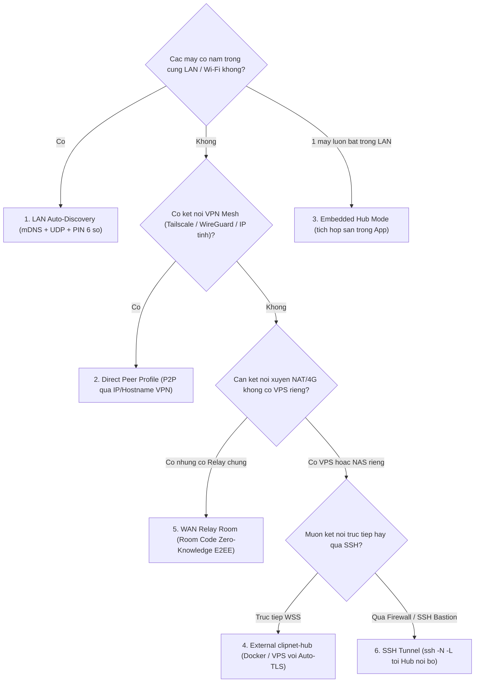

# Cài đặt Đa nền tảng & Tự host `clipnet-hub`

Hướng dẫn chọn gói cài đặt theo từng hệ điều hành/kiến trúc, lựa chọn phương thức kết nối phù hợp và triển khai server `clipnet-hub` độc lập.

---

## 1. Gói Cài đặt Desktop & Binary Phát hành

Các gói phát hành được build tự động qua GitHub Actions cho 6 cấu hình mục tiêu và tải về từ **GitHub Releases** (hoặc tab **Actions** trên nhánh `main`):

| Nền tảng | Kiến trúc | Tệp Desktop Installer | Binary Hub Độc lập | Ghi chú Cài đặt |
| :--- | :--- | :--- | :--- | :--- |
| **Windows 10 / 11** | `x86_64` | `*.msi`, `*-setup.exe` (NSIS) | `clipnet-hub-windows-x86_64.exe` | Khuyên dùng `.exe` (cài theo user hiện tại, không cần quyền Admin) |
| **Windows 11 ARM** | `ARM64` | `*-setup.exe` (NSIS ARM64) | `clipnet-hub-windows-arm64.exe` | Bản native `aarch64-pc-windows-msvc` |
| **Ubuntu / Debian** | `x86_64` (`amd64`) | `*.deb`, `*.AppImage` | `clipnet-hub-linux-x86_64` | Cài `.deb` bằng `sudo apt install ./ClipboardNet_*.deb` |
| **Ubuntu / Debian** | `ARM64` (`aarch64`) | `*.deb`, `*.AppImage` | `clipnet-hub-linux-arm64` | Dành cho Raspberry Pi / ARM64 Linux Desktop & Server |
| **macOS 11+** | Apple Silicon (`arm64`) | `*_aarch64.dmg` | `clipnet-hub-macos-arm64` | Kéo `ClipboardNet.app` vào `/Applications` |
| **macOS 11+** | Intel (`x86_64`) | `*_x64.dmg` | `clipnet-hub-macos-x86_64` | Kéo `ClipboardNet.app` vào `/Applications` |

> **Lưu ý trên macOS đối với bản phát hành mã nguồn mở chưa ký Apple Developer ID:** Nếu macOS báo ứng dụng từ nhà phát triển chưa xác định khi mở lần đầu, vào **System Settings -> Privacy & Security -> Open Anyway** (hoặc chạy `xattr -dr com.apple.quarantine /Applications/ClipboardNet.app`).

### Lưu ý theo Hệ điều hành Desktop

- **Ubuntu GNOME Wayland:** Ứng dụng tự động ưu tiên **XWayland (`XFixes`)** để theo dõi & ghi clipboard nền ổn định mà không cần cài GNOME Shell extension; nếu chạy Wayland thuần không có `DISPLAY`, tự động lùi về `wl-clipboard` (`wl-copy` / `wl-paste`).
- **Windows 10 / 11:** Dùng Win32 format listener gốc qua `clipboard-rs`; không cần quyền quản trị viên khi cài qua NSIS `currentUser`.
- **macOS 11+:** Dùng `NSPasteboard` native trên thread chuyên biệt để đảm bảo an toàn bộ nhớ AppKit.

---

## 2. Sơ đồ Chọn Phương thức Kết nối Phù hợp



---

## 3. Tự host `clipnet-hub` (CLI & Docker)

### 3.1 Chạy bằng Docker Compose (Khuyến nghị)

```bash
docker compose up -d --build
```

Hoặc dùng image multi-arch (`linux/amd64`, `linux/arm64`) đã phát hành trên GitHub Container Registry sau khi push tag:

```bash
docker run -d \
  --name clipnet-hub \
  --restart unless-stopped \
  -p 48220:48220 \
  -v clipnet-hub-certs:/certs \
  -e CLIPNET_TLS=true \
  -e CLIPNET_NAME="ClipboardNet Hub" \
  -e CLIPNET_SECRET="thay-bang-secret-manh" \
  ghcr.io/<owner>/clipnet-hub:latest
```

> **Lưu ý về Volume:** Container `clipnet-hub` chạy dưới user không đặc quyền `clipnet` (`uid/gid 10001`). Named volume `clipnet-hub-certs` tự động kế thừa quyền sở hữu `10001:10001`. Nếu dùng host bind mount (`./hub-certs:/certs`), hãy đảm bảo thư mục host có quyền ghi cho `uid 10001`.

### 3.2 Chạy trực tiếp bằng Binary CLI

```bash
./clipnet-hub --bind 0.0.0.0:48220 --tls --cert-dir ./hub-certs --secret "my-hub-secret"
```

### 3.3 Bảng Biến môi trường & Tham số CLI

| Cờ CLI | Biến môi trường | Mặc định | Mô tả |
| :--- | :--- | :--- | :--- |
| `--bind` | `CLIPNET_BIND` | `0.0.0.0:48220` | Địa chỉ IP và cổng lắng nghe |
| `--tls` | `CLIPNET_TLS` | `false` (`true` trong Docker) | Bật HTTPS/WSS và tự sinh chứng chỉ self-signed (`hub-cert.pem`, `hub-key.pem`) |
| `--cert-dir` | `CLIPNET_CERT_DIR` | `./certs` (`/certs` trong Docker) | Thư mục lưu và đọc cặp chứng chỉ TLS |
| `--secret` | `CLIPNET_SECRET` | Không đặt | Khóa bí mật bắt buộc cho client kết nối `/ws/hub` |
| `--name` | `CLIPNET_NAME` | `ClipboardNet Hub` | Tên hiển thị trong `Welcome` frame và `/health` |

### 3.4 Bảng Cổng Firewall & Kiểm tra Sức khỏe

| Cổng | Giao thức | Thành phần sử dụng | Mục đích |
| :--- | :--- | :--- | :--- |
| `48215` | TCP (WS) | Desktop App (LAN Listener) | Kết nối P2P trực tiếp `/ws/p2p` & ghép đôi PIN |
| `48216` | UDP | Desktop App (Discovery) | Phát & nhận beacon khám phá mạng LAN (`CLIPNET1`) |
| `5353` | UDP Multicast | Desktop App (mDNS) | Dịch vụ `_clipnet._tcp.local.` trên LAN |
| `48220` | TCP (HTTPS/WSS) | Embedded Hub & `clipnet-hub` | Endpoint `/health`, `/ws/hub`, `/ws/relay/{room_id}` |

Kiểm tra endpoint `/health`:

```bash
curl -sk https://localhost:48220/health
```

Ví dụ JSON phản hồi:

```json
{
  "status": "ok",
  "version": "0.1.0",
  "mode": "hub+relay",
  "server_name": "ClipboardNet Hub",
  "hub_clients": 2,
  "relay_rooms": 1,
  "uptime_secs": 3600,
  "tls_fingerprint": "DB08:CA21:..."
}
```

