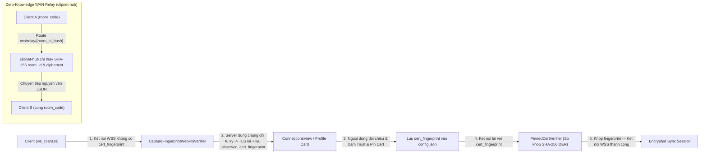

# Giao thức Truyền tải, Mã hóa & Bảo mật

Tài liệu này mô tả chi tiết cấu trúc khung truyền thông (`WireFrame` / `SyncPayload`), cơ chế dẫn xuất khóa mật mã (`HKDF-SHA256`), mô hình xác thực chứng chỉ TLS tự ký và các lớp phòng vệ bảo mật của **ClipboardNet**.

---

## 1. Cấu trúc Khung Giao thức (`crates/clipnet-core/src/protocol.rs`)

Giao thức phiên bản hiện tại là `PROTOCOL_VERSION = 1`, trao đổi qua khung WebSocket văn bản (JSON). Mọi dữ liệu clipboard hoặc tập tin nhạy cảm đều được bọc trong `WireFrame::Encrypted` sau bước bắt tay ban đầu.

### 1.1 Khung Điều khiển Kết nối (`WireFrame`)

| Biến thể | Chiều truyền | Mục đích |
| :--- | :--- | :--- |
| `Hello` | Client -> Peer/Hub | Gửi `device_id`, `device_name`, `os`, `fingerprint`, `protocol_version`, `auth_proof` |
| `Welcome` | Peer/Hub -> Client | Xác nhận kết nối thành công, trả về `server_name`, `server_mode` (`hub`/`relay`/`p2p`), danh sách `peers` |
| `PeerRoster` | Hub/Relay -> Clients | Cập nhật danh sách thiết bị đang online trong Hub hoặc Relay room |
| `Ping` / `Pong` | Hai chiều | Đo độ trễ **RTT (ms)** và giữ kết nối WebSocket (`seq`, `sent_at_ms`) |
| `PairRequest` | Initiator -> Responder | Bắt đầu ghép đôi LAN, gửi thông tin thiết bị và `nonce_hex` (16 bytes) |
| `PairChallenge` | Responder -> Initiator | Trả về thông tin thiết bị đích, `nonce_hex` thứ hai và cờ `requires_pin` |
| `PairConfirm` | Initiator -> Responder | Gửi `shared_secret` 32 bytes mới sinh, đã mã hóa bằng khóa dẫn xuất từ PIN 6 số |
| `PairResult` | Responder -> Initiator | Xác nhận `accepted` hoặc lý do từ chối khi sai PIN / người dùng bấm Reject |
| `Encrypted` | Hai chiều (E2EE) | Mang `sender_id`, `target_id` tùy chọn (`None` = broadcast), và `EncryptedEnvelope` |
| `Error` | Server -> Client | Thông báo lỗi xác thực (`AUTH_FAILED`) hoặc vi phạm giao thức |

### 1.2 Payload Bên trong Lớp Mã hóa (`SyncPayload`)

| Biến thể | Nội dung chính |
| :--- | :--- |
| `ClipboardInline` | `event_id`, metadata thiết bị nguồn, `content_hash`, và `ClipboardData` (`Text`, `Html`, hoặc `ImagePng` base64) |
| `FileOffer` | `transfer_id`, `event_id`, danh sách `FileManifestEntry` (`index`, `rel_path`, `size`, `sha256`), `total_bytes` |
| `FileAccept` | Phản hồi chấp nhận nhận file cho `transfer_id` |
| `FileReject` | Từ chối nhận file kèm `reason` |
| `FileChunk` | Mảnh dữ liệu `256 KB` (`transfer_id`, `file_index`, `offset`, `data_b64`, `is_last_of_file`) |
| `FileComplete` | Xác nhận bên nhận đã kiểm tra toàn vẹn SHA-256 (`ok`, `error`) |
| `FileCancel` | Hủy phiên truyền đang chạy từ một trong hai phía |

---

## 2. Kiến trúc Mật mã & Dẫn xuất Khóa (`crates/clipnet-core/src/crypto.rs`)

Mọi kênh truyền đều sử dụng **AES-256-GCM** với nonce ngẫu nhiên 12 byte (`nonce_b64`) sinh mới cho mỗi thông điệp và **HKDF-SHA256** để dẫn xuất khóa đối xứng 32 byte:

| Thành phần | Công thức / Tham số | Vai trò |
| :--- | :--- | :--- |
| **Symmetric Cipher** | `AES-256-GCM` (`aes-gcm`) | Mã hóa & xác thực toàn vẹn dữ liệu (`nonce_b64` 12B + `ciphertext_b64` + AAD) |
| **KDF** | `HKDF-SHA256` với info `b"clipnet-e2ee-v1"` | Dẫn xuất khóa 256-bit từ secret gốc |
| **LAN / Direct Peer Key** | `derive_key(shared_secret, "clipnet-peer-v1")` | Khóa mã hóa P2P giữa 2 thiết bị đã ghép đôi |
| **Hub / SSH Key** | `derive_key(room_secret, "clipnet-hub-v1")` | Khóa mã hóa nhóm thiết bị dùng chung Embedded/External Hub |
| **LAN Pairing Key** | `derive_key(pin, "clipnet-pair-v1:{nonce_a}:{nonce_b}")` | Khóa tạm thời bảo vệ trao đổi `shared_secret` qua PIN 6 số |
| **WAN Relay Room ID** | `SHA-256("clipnet-room-id-v1:" + room_code)[..16]` hex | Định danh phòng trên server Relay mà không lộ `room_code` gốc |
| **WAN Relay Key** | `derive_key(room_code, "clipnet-hub-v1")` | Mã hóa đầu cuối trên client; server Relay không có khóa này |
| **Hub Auth Proof** | `SHA-256("clipnet-auth-v1:" + secret + ":" + device_id)` | Chứng minh client biết `hub_secret` mà không gửi secret thô trong `Hello` |
| **Device Fingerprint** | `SHA-256("clipnet-fp-v1:" + device_id + identity_key)[..8]` | Hiển thị dạng `XXXX:XXXX:XXXX:XXXX` để đối chiếu trực quan |

---

## 3. Xác thực TLS & Zero-Knowledge WAN Relay

`ws_client.rs` hỗ trợ cả chứng chỉ CA công cộng (WebPKI) lẫn chứng chỉ tự ký (self-signed) của Embedded Hub / `clipnet-hub` thông qua cơ chế **Trust & Pin Cert 1-click**:

---

## 4. Phòng vệ Chiều sâu & Quyền riêng tư

1. **Tự động bỏ qua Password Manager (`is_sensitive_mime_target`):**
   - **Linux:** `x-kde-passwordManagerHint`, `application/x-keepassxc-secret`, `org.freedesktop.secret`
   - **Windows:** `ExcludeClipboardContentFromMonitorProcessing`, `CanIncludeInClipboardHistory`
   - **macOS:** `org.nspasteboard.ConcealedType`, `org.nspasteboard.TransientType`, `com.agilebits.onepassword`
2. **Bộ lọc Regex người dùng (`PrivacyConfig.blocked_patterns`):** Chặn đồng bộ các chuỗi khớp mẫu bí mật tùy chỉnh (API key, token nội bộ, số thẻ...).
3. **Chống Path Traversal khi nhận File (`sanitize_rel_path`):** Từ chối mọi đường dẫn tuyệt đối (`/etc/...`), tiền tố ổ đĩa Windows (`C:\...`), segment `.` / `..`, và ký tự null trước khi ghi vào tệp `.part`.
4. **Kiểm tra toàn vẹn SHA-256:** Từng tệp nhận được phải khớp cả dung lượng kỳ vọng lẫn mã băm SHA-256 trong `FileOffer` trước khi đổi tên từ `.part` sang tệp đích.
5. **Quyền tập tin & Container tối thiểu:**
   - Tập tin cấu hình `config.json` (chứa `identity_key_hex` và `shared_secret`) được lưu với quyền `0o600` trên hệ Unix.
   - Container `clipnet-hub` chạy dưới người dùng không đặc quyền `clipnet` (`uid/gid 10001`).

